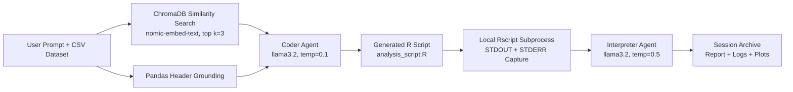

# DataIntellEngine : A Local-First, Multi-Agent RAG Pipeline for Autonomous Biostatistical & Quantitative Data Analysis

[](https://www.python.org/)
[](https://www.r-project.org/)
[](https://ollama.com/)
[](https://www.trychroma.com/)
[](LICENSE)

**A Local-First, Multi-Agent RAG Pipeline for Autonomous Biostatistical & Quantitative Data Analysis**

**DataIntellEngine** is a privacy-preserving, zero-API-cost analytical engine that translates natural-language statistical requests into executable R scripts, runs them locally, and produces structured biostatistical reports. Powered by **Ollama** (`llama3.2` and `nomic-embed-text`), **LangChain**, and **ChromaDB**, it grounds code generation in a curated library of 20 enhanced R statistical functions and live dataset schemas so sensitive clinical or research data never leaves your local network.

---

## Architecture Overview



---

## Key Features

* **100% Local & Private Execution**: Runs entirely on local hardware (tested on Ubuntu Linux / Beelink MINI S13) via Ollama with zero external API calls.
* **Schema-Grounded Code Generation**: Dynamically inspects CSV headers with `pandas` (`nrows=0`) and injects exact column names into the Coder Agent prompt to prevent variable hallucination and auto-correct minor typos.
* **Curated Statistical Knowledge Base**: Ships with 20 structured R function templates spanning descriptive statistics, mixed-effects modeling, survival analysis, dimensionality reduction, clustering, forecasting, and GWAS visualization.
* **Dual-Agent Guardrails & Fallback Autonomy**:
  * **Coder Agent (`temperature=0.1`)**: Enforces exact function reuse and variable mapping, while retaining autonomy to author custom R code (e.g., Cox Proportional Hazards) when a request falls outside the indexed library.
  * **Interpreter Agent (`temperature=0.5`)**: Evaluates both `STDOUT` and `STDERR` logs; reports exact execution failures instead of fabricating statistical outputs.
* **Reproducible Session Archiving**: Every run writes to an isolated `./output/session_YYYYMMDD_HHMMSS/` directory containing the generated `.R` script, raw terminal logs, plots, and a Markdown interpretation report.
* **Vector Space Diagnostics**: Includes a PCA cluster map and L2 query-distance utility (`check_vector_db.py`) to verify RAG retrieval quality.

---

## Repository Structure

```text
DataIntellEngine/
├── README.md                        # Project overview and quickstart
├── requirements.txt                 # Python dependencies
├── .gitignore                       # Ignores vector DB, outputs, venv, Rplots.pdf
├── docs/
│   ├── ARCHITECTURE.md              # Deep-dive technical documentation
│   └── enhanced_*.md                # 20 generated R statistical function templates
├── scripts/
│   ├── generate_r_rag_docs.py       # Generates the 20 enhanced R Markdown docs
│   ├── build_vector_db.py           # Embeds docs/ into persistent ChromaDB
│   ├── check_vector_db.py           # PCA cluster map & similarity diagnostic tool
│   ├── simulate_data.py             # Generates 200-patient synthetic clinical dataset
│   └── rag_orchestrator.py          # End-to-end multi-agent CLI orchestrator
├── clinical_trial_data.csv          # Synthetic test dataset (generated)
├── r_chroma_bd/                     # Local ChromaDB vector store (generated)
└── output/                          # Timestamped analysis sessions (generated)
```

---

## Prerequisites & Installation

### 1. Local AI Runtime (Ollama)

Install [Ollama](https://ollama.com/) and pull the required reasoning and embedding models:

```bash
# Ensure Ollama service is running (Linux/systemd)
sudo systemctl start ollama

# Pull models
ollama pull llama3.2
ollama pull nomic-embed-text
```

### 2. Python Environment

```bash
git clone [https://github.com/rosyaraur/DataIntellEngine.git](https://github.com/rosyaraur/DataIntellEngine.git)
cd DataIntellEngine

python3 -m venv venv
source venv/bin/activate

pip install -r requirements.txt
```

### 3. R Environment & Biostatistical Packages

On Ubuntu/Debian systems, install heavy compiled dependencies via `apt` first, then install specialized statistical packages from CRAN:

```bash
# Pre-compiled system binaries (Ubuntu/Debian)
sudo apt update
sudo apt install -y r-base r-cran-tidyverse r-cran-matrix

# Specialized biostatistics, visualization, and forecasting packages
sudo Rscript -e "install.packages(c('lme4', 'survival', 'survminer', 'lattice', 'reshape2', 'forecast'), repos='[https://cloud.r-project.org/](https://cloud.r-project.org/)')"
```

---

## Quickstart

Run all commands from the repository root with your virtual environment activated:

### Step 1: Generate the R Knowledge Base
```bash
python3 scripts/generate_r_rag_docs.py
```
Creates 20 structured Markdown documentation files in `./docs/`.

### Step 2: Build the ChromaDB Vector Store
```bash
python3 scripts/build_vector_db.py
```
Embeds `./docs/*.md` with `nomic-embed-text` and persists vectors to `./r_chroma_bd/`.

### Step 3: (Optional) Validate Vector Retrieval
```bash
python3 scripts/check_vector_db.py \
  --query "Analyze time-to-event data and plot a survival curve with confidence intervals."
```
Saves a two-panel PCA clustering and L2 distance diagnostic plot to `./output/vector_db_analysis.png` and prints the top retrieved document.

### Step 4: Generate Synthetic Clinical Trial Data
```bash
python3 scripts/simulate_data.py
```
Creates `clinical_trial_data.csv` (200 patients across 12 clinical, biomarker, binary, and survival variables).

### Step 5: Run an Autonomous Analysis
```bash
python3 scripts/rag_orchestrator.py \
  --data clinical_trial_data.csv \
  --prompt "Fit a linear mixed-effects model predicting bp_reduction from treatment and age with clinic_site as a random intercept, and plot the random effects."
```

---

## Session Output Artifacts

Each invocation of `rag_orchestrator.py` creates a self-contained directory under `./output/session_YYYYMMDD_HHMMSS/`:

| File | Description |
| :--- | :--- |
| `analysis_script.R` | Extracted, standalone R script generated by the Coder Agent |
| `execution_log.txt` | Complete `STDOUT` and `STDERR` (plus exit code on failure) from `Rscript` |
| `analysis_report.md` | Biostatistical interpretation and actionable summary from the Interpreter Agent |
| `*.png` / `*.pdf` | Statistical plots generated by the R script |

---

## Supported R Statistical Library (20 Functions)

| Category | Functions | Primary R Packages |
| :--- | :--- | :--- |
| **Descriptive & Diagnostics** | `enhanced_summary_stats`, `enhanced_normality_test`, `enhanced_outlier_detection`, `enhanced_missing_data` | `ggplot2`, `reshape2`, base `stats` |
| **Hypothesis Testing** | `enhanced_ttest`, `enhanced_anova`, `enhanced_wilcoxon`, `enhanced_chi_square`, `enhanced_bootstrap_mean` | `ggplot2`, base `stats` |
| **Regression & Mixed Models** | `enhanced_linear_regression`, `enhanced_logistic_regression`, `enhanced_polynomial_regression`, `enhanced_mixed_model` | `ggplot2`, `lme4`, `lattice` |
| **Survival Analysis** | `enhanced_survival_km` | `survival`, `survminer` |
| **Multivariate & Clustering** | `enhanced_correlation_matrix`, `enhanced_pca`, `enhanced_kmeans`, `enhanced_hierarchical_clustering` | `ggplot2`, `reshape2`, base `stats` |
| **Time Series & Genomics** | `enhanced_arima_forecast`, `enhanced_gwas_manhattan_mock` | `forecast`, `ggplot2` |

---

## Documentation

For detailed pipeline design, prompt engineering guardrails, synthetic dataset specifications, and server deployment notes, see [`docs/ARCHITECTURE.md`](docs/ARCHITECTURE.md).

## Author & License

Developed by **Umesh R. Rosyara** ([GitHub](https://github.com/rosyaraur)).  
Released under the [MIT License](LICENSE).
